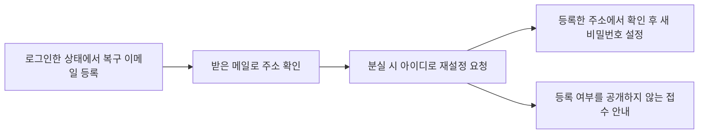

# R07 선택형 복구 이메일

## 현재 동작

자체 계정은 아이디와 비밀번호로 가입한다. Supabase Auth에 등록하는 내부 이메일은 메일을 받을 수 없어서 현재 비밀번호 분실 시 재설정 경로가 없다. Google 로그인 사용자는 Google에서 계정 접근을 복구한다. [현재 계정 계약](../../decisions/account-identity.md)의 복구 경계를 이번 항목에서 재검토한다.

## 확정한 범위

가입 이후 설정에서 복구 이메일을 선택적으로 등록한다. 현재 비밀번호로 본인임을 확인하고, 받은 메일로 주소를 확인한 다음에만 복구에 쓸 수 있다. 로그인 화면에서 아이디로 재설정을 요청하면 등록된 주소에서 한 번 쓸 수 있는 수단으로 새 비밀번호를 정한다. 가입과 로그인에는 지금과 같이 아이디와 비밀번호를 쓴다.



## 검증할 결과

- 기존 자체 계정도 로그인할 수 있을 때 복구 이메일을 등록할 수 있다. 주소 변경과 해제는 현재 비밀번호를 확인한다.
- 메일 확인을 마치기 전에는 그 주소를 복구에 쓰지 않는다. 재설정 요청 응답은 계정이나 복구 주소의 등록 여부를 공개하지 않는다.
- 만료되거나 이미 사용한 재설정 수단으로 비밀번호를 바꿀 수 없다. 새 비밀번호로 로그인하면 이전과 같은 계정의 노트를 열 수 있다.
- 가입 이후에도 복구 수단을 등록하지 않은 계정과 Google 로그인 사용자가 각자의 상황에 맞는 안내를 받는다.

2026-11-15 사용자가 선택형 복구 이메일을 확정했다. 자체 계정의 비밀번호 재설정과 복구 이메일 관리가 이번 범위다. 가입 이후 설정에서 등록할 수 있다. 기존 비밀번호 없이 설정 화면에서 주소를 변경하는 경로, 복구 코드, 계정 삭제, 로그인 수단 추가는 이번 범위에서 제외한다.

## 운영 설정과 확인

- 현재 가입·로그인은 내부 이메일을 계산해 사용한다. Supabase의 기본 재설정은 Auth에 등록된 이메일 주소를 받으므로 현재 호출에 재설정 화면만 추가해서는 메일이 도착하지 않는다. 사용자용 로그인 식별자를 보존하면서 검증된 주소로 보내는 경로를 별도로 검증한다. [Supabase 비밀번호 인증](https://supabase.com/docs/guides/auth/passwords#resetting-a-password)
- 아래 마이그레이션을 Supabase SQL Editor에서 실행한다. 비밀번호는 검증 링크를 소비한 뒤 Supabase Auth에서 갱신한다. [R07 SQL](../../../supabase/migrations/20261115111656_account_recovery.sql), [Supabase Auth 관리자 API](https://supabase.com/docs/reference/javascript/auth-admin-updateuserbyid)
- 발송은 Resend를 사용한다. 일반 사용자에게 발송할 때는 도메인을 인증하고 해당 도메인의 발신 주소와 발송 전용 키를 설정한다. 본인에게만 보내는 로컬 테스트는 `onboarding@resend.dev`를 발신 주소로 쓰고 Resend 가입 이메일을 복구 주소로 등록할 수 있다. [Resend 발송 API](https://resend.com/docs/api-reference/emails/send-email), [테스트 발송 제한](https://resend.com/docs/knowledge-base/403-error-resend-dev-domain)

개발 환경의 `.env.local`과 운영 환경의 서버 환경 변수에 다음 값을 각각 지정한다. 이메일 링크는 여기에 지정된 앱 주소로만 만든다. 비밀 키는 서버 환경에만 둔다.

```dotenv
SUPABASE_SECRET_KEY=<Supabase sb_secret_ 키>
RESEND_API_KEY=<Resend 발송 전용 키>
RECOVERY_EMAIL_FROM=<인증된 발신 주소>
RECOVERY_APP_ORIGIN=http://localhost:3000
```

운영 환경의 `RECOVERY_APP_ORIGIN`은 앱의 실제 HTTPS 주소를 사용한다. Resend의 링크 추적은 꺼 둔다. 운영 확인은 테스트 계정에서 주소 확인 메일과 재설정 메일을 각각 수신하고, 재설정 후 기존 노트에 접근할 수 있는지 확인한다.

## 검증 결과

- 임시 PostgreSQL에서 공개 역할 접근 거절, 확인 전 재설정 요청 거절, 발송 간격, 링크 만료·일회용 사용, 주소 변경·해제 후 이전 링크 무효화를 확인했다.
- 브라우저에서 실제 테스트 계정의 현재 비밀번호를 확인했다. 메일과 복구용 데이터 API 및 관리자 비밀번호 갱신 응답을 대체해 주소 확인과 재설정 흐름을 검증했다. [브라우저 테스트](../../../e2e/read-errors.spec.ts)
- 타입 검사와 앱·테스트 lint, 기존 단위 테스트 135개를 통과했다.
- 실제 Supabase와 Resend를 연결한 브라우저 테스트에서 주소 확인 메일과 비밀번호 재설정 메일이 Resend에 접수됐다. 발송 요청의 링크로 주소를 확인하고 비밀번호를 갱신했다. 이미 사용한 링크와 이전 비밀번호는 거절됐고, 새 비밀번호로 로그인해 저장한 테스트 노트의 제목과 본문을 다시 확인했다. 받은편지함에 표시됐는지는 수신자가 확인한다.

## 관련 기준

- [계정 계약](../../decisions/account-identity.md)은 아이디 로그인과 복구 이메일의 용도를 정한다.
- [제품 정의](../../../PRODUCT.md)는 계정 기반 개인 저장소를 정한다.
- [화면 기준](../../design/amu-note-screens.html)과 [UI 구성](../../decisions/ui-composition.md)에 따라 기존 로그인 카드와 설정의 계정 영역을 확장한다.
